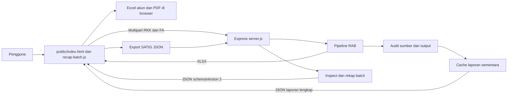
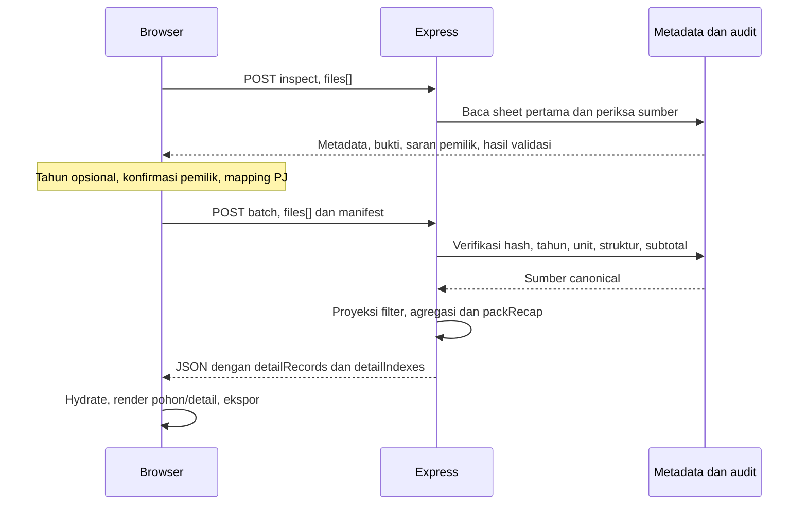

# Architecture

Tanggal pembaruan: 27 Oktober 2026. Versi package: 3.9.0, sesuai rilis pada [CHANGELOG.md](CHANGELOG.md).

Dokumen ini menjelaskan implementasi saat ini. Kebutuhan produk ada di [PRD.md](PRD.md), kontrak data di [Schema.md](Schema.md), dan perilaku antarmuka serta ekspor di [Design.md](Design.md).

## 1. Gambaran sistem

Excel Processor V3 mengubah workbook RKK Satker menjadi RAB perbandingan SEMULA/MENJADI, mencocokkan FA opsional, dan menghasilkan rekap hirarki satu atau beberapa sumber. Backend menggunakan Node.js CommonJS, Express, Multer memory storage, dan ExcelJS. Frontend berupa HTML, CSS, dan JavaScript tanpa framework atau proses build frontend.



Workbook diunggah sebagai buffer, diproses di memori, lalu dikembalikan ke browser. Tidak ada database, penyimpanan upload permanen, antrean pekerjaan, atau autentikasi aplikasi. Penyimpanan browser yang teridentifikasi adalah preferensi sidebar melalui localStorage; data batch berada pada state halaman.

## 2. Pembagian komponen

| Komponen | Tanggung jawab | Sumber |
| --- | --- | --- |
| HTTP dan static hosting | Route, multipart, batas ukuran, respons unduhan, cache laporan | [server.js](server.js) |
| Entry deployment | Mengekspor instance Express yang sama | [api/index.js](api/index.js), [vercel.json](vercel.json) |
| Orkestrasi RAB | Menjalankan enam tahap pemrosesan | [src/processor.js](src/processor.js) |
| Normalisasi dan audit | Entitas logis multibaris, provenance, struktur dan subtotal | [rkk-detail-normalizer.js](src/utils/rkk-detail-normalizer.js) |
| Formula | Hierarki anak langsung dan evaluasi untuk audit | [budget-hierarchy.js](src/utils/budget-hierarchy.js), [formula-evaluator.js](src/utils/formula-evaluator.js) |
| Rekap | Parsing sumber, agregasi anggaran, pohon dan daftar akun | [hierarchy-recap.js](src/utils/hierarchy-recap.js) |
| Batch dan identitas | Inspect, unit, manifest, proyeksi filter, pemadatan JSON | [hierarchy-recap-batch.js](src/utils/hierarchy-recap-batch.js), [rkk-metadata.js](src/utils/rkk-metadata.js) |
| Frontend | Upload, validasi, drilldown, filter, unduhan | [public/index.html](public/index.html), [public/recap-batch.js](public/recap-batch.js) |
| Riwayat rilis | Data changelog aplikasi dan riwayat Git lokal | [src/utils/changelog.js](src/utils/changelog.js) |

## 3. Pipeline konversi RAB

1. `01-parse-input`: baca XLSX, lepas merge, bersihkan representasi teks tanpa menimpa formula.
2. `02-restructure`: normalisasi detail/header/grup, rapikan kolom dan metadata, serta pecah rincian perhitungan.
3. `03-formulas`: hitung volume, jumlah, dan subtotal hirarki.
4. `04-map-to-rab`: buat header tiga baris, salin blok SEMULA/MENJADI, buat SELISIH dan ringkasan per RO, serta bentuk kembali formula output.
5. `05-styling`: font, warna tingkat hirarki, border, ukuran, dan pengaturan cetak workbook.
6. `06-fa-matching`: bila FA diberikan, isi REALISASI/SISA dan subtotalnya; hasilkan ringkasan pencocokan.

`00-validate-input` dipakai oleh endpoint validasi dan pemeriksaan batch, bukan tahap yang dipanggil langsung oleh `processExcel`. Sesudah pipeline, `handleProcess` menjalankan `level-validator` untuk membandingkan sumber dengan output. Status DIFF atau INCOMPLETE tetap dapat menyertai respons XLSX sukses; status HTTP 200 tidak berarti seluruh angka cocok.

Formula subtotal memakai anak langsung agar parent dan keturunannya tidak dihitung bersamaan. Audit menghitung total program terpisah dari total detail. Selisih perkalian volume/harga terhadap jumlah sumber dipertahankan sebagai temuan, bukan dipaksa menjadi nol.

FA dibaca dari worksheet pertama. Pencocokan dua tahap memakai akun, komponen, subkomponen, RO, uraian, dan pada tahap pertama pagu. Tahap kedua melepas syarat pagu. Satu detail FA hanya dapat dipakai sekali dalam proses pencocokan. Detail blokir dan detail tidak ditemukan diberi nol di kolom REALISASI/SISA, disertai kategori pada laporan.

## 4. Alur rekap batch



Identitas sumber adalah SHA-256 isi file. Nama file tidak menentukan unit atau tahun. Saran pemilik memakai header dan bukti isi; pengguna tetap wajib mengonfirmasi. Registry bawaan berisi BBPKK Bandung Barat, BPKK Bekasi, dan BPKK Kendari; unit tambahan dikirim dalam manifest.

Program yang sama digabung lintas sumber pada tahun batch. Tahun input opsional: backend menggunakan tahun input, satu tahun terdeteksi, atau null jika tidak diketahui. Tahun terdeteksi yang berbeda antar sumber selalu ditolak sebelum filter diterapkan; input yang tidak cocok juga ditolak. Cabang mulai Kegiatan dipisahkan menurut tahun (termasuk null), pemilik, penanggung jawab, dan path kode. Kode kegiatan unik dan jumlah cabang kegiatan adalah dua metrik berbeda. Filter pemilik/PJ dijalankan di backend dengan upload ulang sumber, sedangkan filter akun/sumber dana/blokir dan pencarian dijalankan di browser.

Parser meneruskan target/satuan KRO dan RO dari volume kolom G RKK ke summary/tree tanpa agregasi lintas cabang. Frontend mengirim node hasil fokus/pencarian level 2–6 ke POST /api/recap-hierarchy/export. Backend ExcelJS menulis satu sheet Kegiatan-KRO-RO, memakai profil format template SATIG yang disertakan dalam src/config/satig-export-template.json. Blok satker mengikuti pemilik dan urutan sumber terpilih, subtotal menjumlahkan anak langsung yang diekspor, Unit Cost RO menggunakan target positif. Endpoint memvalidasi bentuk/relasi node (maksimal 30.000 node dan 4 MiB JSON) tanpa mengunggah ulang sumber; respons binary XLSX tidak disimpan permanen. Kolom A menampilkan label tingkat; B:I tetap mengikuti template. Outline dibangun saat traversal induk–anak per satker, dengan induk di atas rincian dan seluruh grup terbuka. Ekspor penuh menyediakan tombol 1–7 dari Grand Total sampai Subkomponen; fokus tanpa leluhur merapatkan kedalaman dari akar rincian. Header termasuk grup rincian satker. ExcelJS menurunkan flag collapsed dari kedalaman maksimum; eksportir mengesetnya false pada baris agar terminal tetap terbuka tanpa menambah tingkat kosong. Tidak ada metadata tambahan.

Inspect dapat mengembalikan file invalid bersama file valid untuk review. Batch menolak keseluruhan permintaan jika satu sumber atau manifest gagal; tidak ada hasil sukses parsial. Detail JSON disimpan sekali, lalu referensinya dipakai pada banyak ringkasan node untuk mengurangi ukuran payload.

Inspect dan batch saat ini masing-masing membaca workbook dua kali per sumber: `loadSource` untuk metadata dan `validateInput` melalui `parseInput`. Sumber diproses berurutan, dan hasil canonical inspect tidak disimpan untuk request batch/filter berikutnya. Normalisasi audit di-cache pada objek worksheet, bukan lintas pembacaan/request. Benchmark lokal menunjukkan biaya dominan pada pembacaan XLSX dengan banyak merge. Rencana loader bersama, optimasi merge, reuse sumber, payload/render dan pembatalan dicatat di [improvement.md](improvement.md); belum diimplementasikan pada 3.9.0.

## 5. Endpoint dan sumber daya

Kontrak route dan payload lengkap dijelaskan di [Schema.md](Schema.md).

| Area | Batas implementasi |
| --- | --- |
| Upload pemrosesan/legacy | 50 MiB per file pada Multer umum |
| Batch | 10 file; 5 MiB/file; total 20 MiB |
| Workbook batch | Maksimal 10 sheet; sheet pertama maksimal 30.000 baris dan 100 kolom |
| Manifest multipart | Satu field; maksimal 128 KiB |
| Respons batch | Maksimal 4 MiB JSON setelah pemadatan |
| Waktu inspect/batch | Deadline 60 detik yang dicek antar tahap/file; bukan penghentian paksa pekerjaan CPU |
| Laporan audit | Masa berlaku 10 menit; maksimal 20 entri, 64 MiB total, 32 MiB per laporan |

Cache laporan adalah Map dalam instance proses. Restart, eviction, atau permintaan ke instance deployment berbeda dapat membuat URL laporan tidak tersedia. URL UUID memungkinkan akses laporan tanpa autentikasi. CORS saat ini diaktifkan tanpa pembatasan origin pada middleware.

Pembatalan frontend memakai AbortController dan nomor generasi untuk menolak respons usang. Membatalkan fetch tidak menjamin pekerjaan backend berhenti. Pengambilan laporan validasi lengkap memiliki timeout browser 20 detik.

## 6. Menjalankan dan menguji

```bash
npm ci
npm start
# Pengembangan
npm run dev
# Suite rekap
npm run test:recap
```

Server lokal memakai `PORT` atau 3000. `vercel.json` mengarahkan `/api/*` dan `/health` ke entry Express serta `/changelog` ke halaman statis. Konfigurasi ini tidak menjamin batas upload, durasi, atau persistensi cache suatu platform; batas platform harus diperiksa ketika deployment dilakukan.

Suite rekap mencakup metadata, batch, API, simulasi DOM frontend, dan audit RKK. Sampel lokal dapat diatur melalui `RECAP_SAMPLE_DIR`; integrasi lima workbook dilewati secara eksplisit jika sampel tidak lengkap. Workbook, folder context/data/scratch, dan node_modules diabaikan Git. Pemeriksaan DOM tidak menggantikan pemeriksaan visual browser atau Microsoft Excel.

## 7. Batas dan arah pengembangan

Implementasi belum menyediakan riwayat pekerjaan permanen, pemetaan manual kandidat normalisasi, pembagian satu kegiatan ke beberapa PJ, atau workbook arbitrer di luar pola yang didukung. UI masih menawarkan `.xls` pada pemrosesan umum, sedangkan mesin pembaca menggunakan XLSX; dukungan XLS biner belum dibuktikan.

Jika kebutuhan meningkat, penyimpanan laporan bersama antar instance, job queue, kontrol akses, dan pemisahan modul frontend dapat dipertimbangkan. Hal tersebut merupakan opsi pengembangan, bukan komponen yang sudah tersedia.

Sebelum setiap push, ikuti [AGENTS.md](AGENTS.md): perbarui changelog dan seluruh dokumen terdampak, lalu jalankan pemeriksaan yang sesuai.
