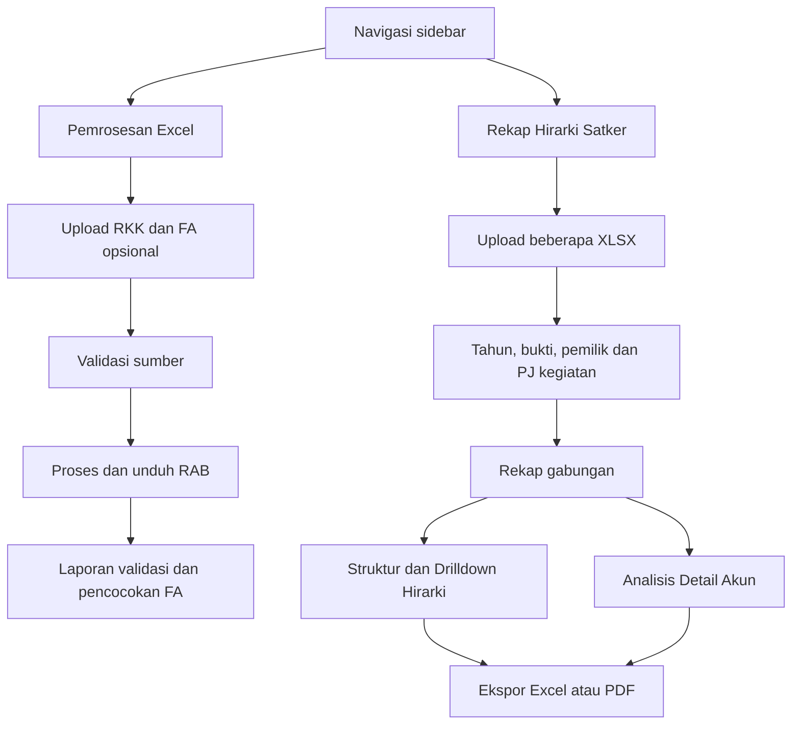

# Design

Tanggal pembaruan: 13 Oktober 2026. Desain berdasarkan antarmuka dan ekspor yang tersedia pada package 3.6.1 beserta perubahan Unreleased. Dokumen ini memuat perilaku UI, keputusan implementasi, dan format artefak. Kebutuhan bisnis ada di [PRD.md](PRD.md); struktur sistem dan data ada di [Architecture.md](Architecture.md) dan [Schema.md](Schema.md).

## 1. Tujuan desain

Pengguna perlu mengolah RKK, memeriksa perubahan angka, menelusuri hirarki anggaran, dan membawa hasil ke Excel/PDF. Antarmuka mengutamakan upload sumber, status pekerjaan yang terlihat, bukti identifikasi unit, serta drilldown dari ringkasan ke detail dengan provenance.

Desain memisahkan tiga hal: kelayakan sumber sebelum proses, perbandingan angka sesudah proses, dan pencocokan FA. File yang berhasil diunduh belum tentu memiliki status audit MATCH. Selisih, data hilang, dan pemeriksaan yang belum lengkap tetap ditampilkan.

## 2. Struktur halaman

Sidebar dapat dilipat, dengan preferensi tersimpan melalui localStorage. Pada layar sempit tersedia overlay navigasi dan tabel yang dapat digulir. Footer/badge versi menghubungkan pengguna ke halaman changelog. Halaman utama masih memuat banyak handler inline; pengaturan batch berada dalam `public/recap-batch.js` dan styling utama dalam `public/style.css`.

## 3. Bahasa visual

| Token CSS | Nilai | Penggunaan |
| --- | --- | --- |
| `--bg-primary` | `#0f172a` | Latar halaman |
| `--bg-secondary` | `#1e293b` | Permukaan panel |
| `--bg-card` | `rgba(30,41,59,0.7)` | Kartu transparan |
| `--text-primary` | `#f8fafc` | Teks utama |
| `--text-secondary` | `#94a3b8` | Keterangan pendukung |
| `--text-muted` | `#64748b` | Teks redup |
| `--accent-primary` | `#38bdf8` | Aksi/informasi |
| `--accent-success` | `#22c55e` | Sukses |
| `--accent-warning` | `#f59e0b` | Perhatian/blokir |
| `--accent-danger` | `#ef4444` | Error/selisih |

Font menggunakan stack `Inter`, system-ui, dan sans-serif. Kartu memakai border transparan, sudut membulat, serta gradien latar; ikon menggunakan Font Awesome. Warna tingkat hirarki, label kode, dan indentasi membantu pengguna membedakan induk/anak. Sebagian warna komponen masih ditetapkan inline; token di atas bukan satu-satunya sumber styling.

Warna status disertai teks, jumlah, dan rincian. Dukungan aksesibilitas yang ada meliputi label form, status kontrol, dan penjelasan filter kosong; belum ada bukti audit aksesibilitas menyeluruh atau pengujian navigasi keyboard semua komponen.

## 4. Pemrosesan RKK dan FA

Area upload menyediakan pilih file atau drag-and-drop. RKK wajib; FA opsional. Setelah validasi input, pengguna menjalankan proses lalu menerima RAB dan ringkasan audit. Laporan JSON lengkap dimuat otomatis untuk menghindari keterbatasan rincian di header HTTP.

Panel laporan menyediakan ringkasan program, detail berbeda, subtotal, normalisasi, masalah struktur, dan diagnostik. Status MATCH, DIFF, atau INCOMPLETE mengikuti hasil validator, bukan hanya keberhasilan HTTP. Pengambilan laporan memiliki loading, timeout 20 detik, penanganan kedaluwarsa/error, dan Coba lagi. Unduhan JSON menjadi pelengkap rincian di halaman.

Pencocokan FA membedakan detail normal yang cocok, tidak ditemukan, dan diblokir. Persentase pencocokan memakai detail normal sebagai penyebut. Daftar pada ringkasan FA dibatasi oleh backend; jumlah keseluruhan tetap ditampilkan melalui field hitungan. Nilai nol pada output FA perlu dibaca bersama kategori pencocokannya.

## 5. Review batch dan status pekerjaan

Setiap sumber memiliki kartu yang menampilkan nama file, kelayakan, saran unit dari isi, lokasi/KPPN, bukti sel, pilihan pemilik, konfirmasi, dan mapping PJ per kegiatan. Tahun anggaran merupakan pilihan eksplisit. Unit baru dapat ditambahkan jika registry bawaan tidak mencukupi.

Tombol pembuatan rekap hanya aktif jika sumber valid, pemilik sudah dipilih/dikonfirmasi, tahun sesuai, dan tidak ada pemilik duplikat. Mengubah pemilik membatalkan konfirmasi. Kegiatan tanpa mapping PJ mengikuti pemilik file; kode kegiatan yang sama pada dua unit tetap menjadi dua cabang.

Saat inspect atau batch berjalan, panel loading sticky menampilkan tahap, spinner, durasi, dan penjelasan kontrol terkunci. Kontrol yang mengubah permintaan dinonaktifkan. Pembatalan menghentikan fetch dan mencegah respons lama dipakai melalui nomor generasi. Setelah batal/error, pengguna dapat memeriksa ulang. Perubahan upload atau atribusi membersihkan hasil lama agar tidak diekspor sebagai hasil sumber baru.

Perubahan filter pemilik/PJ memicu pembuatan ulang batch melalui API. Browser masih memegang File asli untuk dikirim kembali; ini bukan query ke data batch tersimpan di server.

## 6. Struktur dan drilldown hirarki

Tab struktur adalah tampilan awal hasil rekap. Lingkup awal berupa total file terpilih. Pengguna dapat memfokuskan Program, Kegiatan, KRO, RO, Komponen, atau Subkomponen, lalu melihat metrik dan daftar tingkat di bawah lingkup tersebut.

Tabel pohon menampilkan tujuh tingkat sampai Akun, jumlah anak, pagu per sumber dana, total blokir, persentase, dan rincian kode blokir. Kontrol buka/tutup per node dan pintasan tingkat mempermudah navigasi. Kartu metrik membuka rincian untuk tingkat terkait dengan pencarian dan total.

Pencarian struktur mempertahankan induk yang dibutuhkan agar hasil tetap dapat dipahami. Ekspor mengikuti fokus cabang dan pencarian aktif; keadaan buka/tutup tabel web tidak membatasi node yang diekspor. Pencarian tanpa hasil menampilkan pemberitahuan dan tidak mengunduh workbook struktur kosong.

## 7. Analisis detail akun

Tab detail menyediakan filter lingkup, akun digit 6, sumber dana, status blokir, kode blokir, dan pencarian. Pilihan sumber dana/status/kode mengikuti konteks akun dan pencarian aktif. Pilih Semua dan Bersihkan mengikuti ketersediaan pilihan.

Filter dengan pilihan kosong tetap merespons klik melalui penjelasan dan petunjuk. Detail normal tetap dapat ditampilkan saat pilihan kode blokir dibersihkan; detail diblokir tanpa kode diperlakukan sebagai kategori yang dapat diperiksa. Baris rincian batch menampilkan sumber file/sheet/baris dan atribusi unit agar angka dapat ditelusuri.

Terdapat dua konteks filter yang berbeda: filter pemilik/PJ pada server mengubah dataset rekap, sedangkan filter detail dan pencarian struktur mengubah tampilan/ekspor dari dataset tersebut. Ekspor akun mengikuti filter detail; ekspor pohon mengikuti fokus/pencarian struktur.

## 8. Desain artefak unduhan

### RAB hasil backend

Workbook memakai dua blok SEMULA dan MENJADI masing-masing 20 kolom, dilanjutkan SELISIH, REALISASI, SISA, dan ringkasan per RO. Header tiga baris, warna tingkat hirarki, border, dan font Arial 6 pt ditetapkan oleh tahap styling. Formula dipertahankan agar workbook dapat dihitung ulang di Excel. Blok tanda tangan TTE disediakan oleh pemetaan output.

### Excel rekap berjenjang

| Elemen | Format saat ini |
| --- | --- |
| Judul | B1, Calibri 14 pt, tebal, `#1E3A5F` |
| Metadata | Label B2:B9 tebal; nilai C2:C9; kolom A kosong pada baris 1–9 |
| Pemisah | Baris 10 kosong |
| Header tabel | A11:L11, tinggi 42 pt, biru tua `#1E3A5F`, teks putih tebal, rata tengah, wrap |
| Sel tabel | Calibri 11 pt, border tipis empat sisi `#94A3B8`, vertical center, wrap; termasuk sel kosong |
| Pagu | Angka dengan format `#,##0` |
| Persentase | Rasio dengan format `0.0%` |
| Lebar kolom | A:L: 8, 24, 25, 55, 16, 18, 16, 16, 16, 18, 12, 45 karakter |
| Outline | Induk di atas anak; Program=0 sampai Akun=6 pada ekspor penuh |

Pada fokus cabang, induk fokus berada pada depth 0. Header dan metadata tidak termasuk outline. Sheet `Sumber dan Atribusi` menyertakan sumber batch; styling tabel di atas berlaku pada sheet `Pohon Hirarki`. Penulis browser adalah xlsx-js-style 1.2.0 agar warna/border tersimpan di file.

### PDF dan ekspor akun

PDF struktur menggunakan landscape A4, ringkasan lingkup, tabel hirarki, dan atribusi sumber. Ekspor akun menghasilkan rincian berdasarkan filter detail aktif. Empat jalur rekap memakai xlsx-js-style atau jsPDF/AutoTable di browser; RAB memakai ExcelJS di backend. Format dan nomor kolom RAB berbeda dari rekap berjenjang.

## 9. Ketergantungan dan batas desain

Browser mengambil library XLSX, jsPDF, AutoTable, dan Font Awesome melalui CDN. Jika library ekspor belum tersedia, handler menampilkan pemberitahuan. Aplikasi belum memiliki bundling offline atau fallback CDN lokal.

Data nama/uraian/bukti disajikan dengan escaping pada jalur rekap yang diuji. Proyek tidak menyediakan login, pembatasan per peran, atau histori upload lintas sesi. Pemilihan unit merupakan atribusi data, bukan otorisasi akses. Laporan sementara dapat hilang akibat masa berlaku atau pergantian instance.

Tidak ada pemaksaan hasil cocok melalui penghapusan detail identik atau pengabaian validasi. Kandidat normalisasi yang tidak dapat diputuskan otomatis dilaporkan untuk koreksi sumber; UI keputusan manual per kandidat belum tersedia.

## 10. Verifikasi dan pemeliharaan

`npm run test:recap` memeriksa loading, pembatalan, retry, respons usang, escaping, filter kosong, hidrasi detail, empat jalur ekspor, dan outline melalui simulasi DOM. Pada perubahan ekspor 13 Oktober, serialisasi penulis browser dan pembacaan kembali ExcelJS memverifikasi metadata, border pada 6.840 sel, warna header, nilai, format angka/persen, serta outline untuk sampel 569 baris hirarki.

Pemeriksaan visual browser dan Microsoft Excel belum dilakukan pada sesi ini. Pemeriksaan tersebut masih diperlukan untuk clipping metadata, tinggi baris otomatis, cetak, responsive layout, dan interaksi keyboard. Jangan menyatakan audit visual lulus berdasarkan tes DOM atau pembacaan XLSX saja.

Saat mengubah UI/ekspor, selaraskan dokumen ini, [Schema.md](Schema.md), [PRD.md](PRD.md), dan changelog sesuai dampak perubahan. Saat mengubah alur sistem, perbarui [Architecture.md](Architecture.md). Ikuti aturan sebelum push di [AGENTS.md](AGENTS.md).
